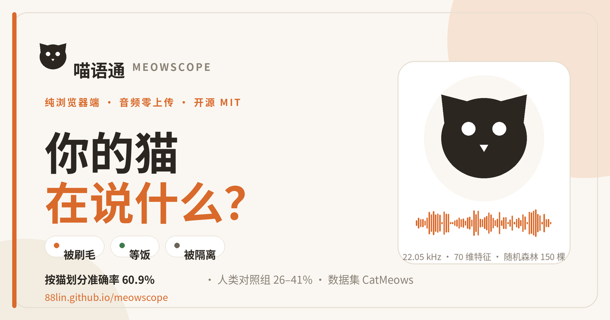
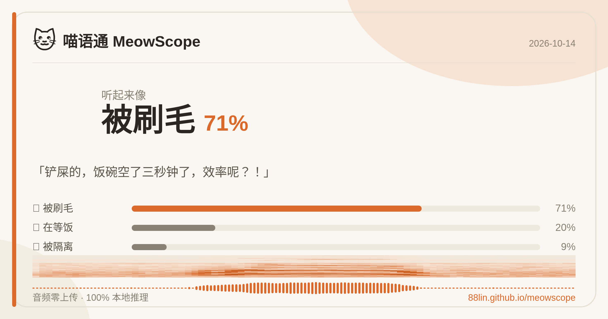

# 喵语通 MeowScope 🐱

  

**在浏览器里听懂猫在说什么。** 录音或上传猫叫，本地 AI 实时判断它在哪种情境下发声（被刷毛 / 等饭 / 被隔离）——所有计算都在你的浏览器完成，**音频不会上传到任何服务器**。

在线体验：https://88lin.github.io/meowscope/ （或直接打开 `public/index.html` 本地跑）

> 分享到微信 / X / Telegram 时的链接预览图：
> 

分析结果可以一键生成 1200×630 的分享卡片（含波形、三条概率、置信度），直接保存或复制：



## 它能听懂什么

| 情境 | 场景 | 特点 |
|---|---|---|
| 🪮 被刷毛 brushing | 主人梳毛时 | 短促、音调平缓 |
| 🍚 等饭 waiting_for_food | 站在食盆前 | 急促重复、最有辨识度 |
| 🚪 被隔离 isolation | 被独自留在陌生环境 | 鸣叫更长、音更高 |

先说实话：**喵语没有百科全书**。这个模型只做情境分类，不做"翻译句子"。同一声喵在不同猫、不同场合含义可以完全不同（学界称为 *semantic aliasing*，语义混叠）。

## 诚实的成绩单

训练/测试**按猫划分**（模型从未听过测试集里那只猫的声音），不是作弊的随机划分：

| 指标 | 数值 | 说明 |
|---|---|---|
| 按猫分组 5 折交叉验证 | **60.2%** | 训练与测试永远来自不同的猫 |
| 留一猫验证 (LOSO) | **59.8%** | 每折只留一只猫当测试集 |
| macro-F1（三类平均） | **52.6%** | 把少数类也算进来，防止靠「一律猜被隔离」刷分 |
| **多数类基线** | **50.2%** | 完全不训练、一律猜「被隔离」的分数——这才是真正的地板 |
| 随机猜 | 33.3% | 三选一 |

细节见 [`public/metrics.json`](public/metrics.json)。请特别注意**多数类基线 50.2%**：`isolation` 占了数据集一半，所以「60% 准确率」相对随机的 33% 看起来不错，但相对不训练也就高了 10 个百分点。这是我们选择公开多数类基线的理由。

### 为什么不去追文献里的 90%+

| 工作 | 报告准确率 | 评测方式 |
|---|---|---|
| Ntalampiras 2019（同源数据，DAG-HMM） | 95.94% | 10 折**随机**划分 |
| Pandeya 2018 | 91.13% | 随机划分 |
| Ferdiana 2021 | 88.47% | 随机划分 |
| Purrai | 81.1% | 随机划分 |
| **本模型** | **59.8–60.2%** | **按猫划分** |

同一只猫的几十段录音被随机分到训练集和测试集，模型只要记住「这只猫的声音长什么样」就能拿高分——这叫**个体泄漏**。我们检索到的公开猫叫分类工作中，**没有一篇报告按个体划分的数字**。所以那些 90%+ 与本项目的 60% 不是同一把尺子，差距主体是评测协议，不是模型。

参照系：Nicastro & Owren (2003) 与 Prato-Previde et al. (2020) 测得**人类**分辨陌生猫发声情境仅 26-41% 正确——本模型高于陌生人，但远低于「养猫人听自家猫」。

## 已知上限与下一步

我们已经用实验确认了这条手工特征路线的天花板（下面都是按猫划分、多种子重复评估的结果）：

| 尝试 | 结果 |
|---|---|
| 更丰富的谱特征（谱对比度/带宽/平坦度，107 维） | 准确率持平，macro-F1 略升——**加特征已经不涨分了** |
| 改用 MLP / SVM / 梯度提升 / 集成 | 准确率持平或下降（MLP 在 LOSO 上 macro-F1 更高，但在 5 折上明显更差，不稳定） |
| 数据增强（加噪、变速、音量） | **反而降分**：440 条样本下增强主要引入噪声，不是新信息 |
| 采样率从 22.05k 降到 8k（对齐数据集原生采样率） | 降分（8k LOSO 53.6% vs 22.05k 56.8%）——假设被证伪 |
| 把随机森林从 400 棵换到 150 棵 + 深度上限 10 | **精度不变，模型体积降到 1/3** ✅ |

结论：继续堆手工特征不会带来质变。真正的跃升来自**预训练音频表征**——Ghani 等 (2023) 显示在小样本动物叫声上，冻结的 Perch embedding + 逻辑回归能达到 0.74–0.92，而同数据集的 MFCC+MLP 基线近乎随机；AVES 在 10 只狗的个体分类上也远超 SVM。路线是：离线用 Perch/AVES 提 embedding，蒸馏成一个能在浏览器里跑的小模型（几百 KB 级）。这是对本项目最有价值的下一步，欢迎 PR。

## 用起来顺手吗（交互）

- **四种方式喂音频**：录音、选择文件、**把文件拖到卡片上**、**Ctrl/⌘+V 粘贴**
- **空格键**开始 / 停止录音（焦点不在按钮或输入框上时）
- **暗色模式**：跟随系统，也可用右上角 🌙 手动切换（记在 localStorage）
- **置信度环**：结果区直接显示把握有多大，配三条概率条
- **最近几次**：连续录几段时可在结果下方来回切换回看，方便对比（只存内存）
- **对照示例**：一键播放判定类别在数据集里的真实猫叫，跟自己的录音比一比
- **导出分享图**：1200×630 PNG，含波形、三类概率、日期
- 移动端 44px 触控目标；浅色/深色两套配色均满足 WCAG AA 正文对比度

## 工作原理

```
音频 → 22.05kHz 单声道 → 95 维特征（MFCC + 差分 + 谱统计 + YIN 音高 + 时长）
     → 随机森林 150 棵（深度上限 10）→ 三类概率
```

- **特征**：MFCC 用纯 JS 实现了 librosa 的完整管线（slaney mel 滤波器组、periodic Hann、DCT-II ortho、power→dB top_db=80），与 Python 逐位对拍，CI 每次提交都会跑（`python3 scripts/parity_check.py`）。STFT 用 radix-2 FFT 实现，与改造前的朴素 DFT 对拍**最大相对差 ~2e-12**。
- **训练/推理一致性**：浏览器里的特征提取必须与 `scripts/train.py` 完全一致，否则模型等于在用另一套输入。曾经这里踩过坑——谱质心/谱滚降按功率谱算（librosa 用幅度谱）、分帧少了 center padding、delta 边缘处理不同、过零率差 1 个计数，导致质心 3729 vs 2075 这种量级的偏差。现在由 CI 闸门守住。
- **模型**：随机森林——在 440 样本的小数据上比深度网络更稳、且无需张量库。150 棵、深度上限 10，导出为紧凑数组格式的 JSON，**216KB**（gzip 后几十 KB）。
- **速度**（2 秒音频实测，Chromium）：特征提取 ~40ms + YIN 音高 ~120ms + 森林推理 ~1ms，合计约 0.2 秒。改用 FFT 之前，朴素 DFT 让特征提取要 1.1–1.4 秒。
- **重采样一致性**：训练加载器（`train.py:_load_linear`）与网页 wav 解析路径使用完全相同的线性插值，保证训练/推理看到同一段波形。浏览器录音（webm/mp3）走 Web Audio 解码 + 同样的降采样。

## 复现

```bash
# 1. 数据：CatMeows (Zenodo, CC-BY-NC)
curl -L -o dataset.zip https://zenodo.org/api/records/4008297/files/dataset.zip/content
python3 -c "import zipfile; zipfile.ZipFile('dataset.zip').extractall('data/')"
# 解压后 wav 在 data/dataset/，文件名前缀 B/F/I 即类别
# 数据集是 CC BY-NC：可研究可开源分发，禁止商用

# 2. 训练
pip install librosa scikit-learn joblib numpy scipy
python3 scripts/train.py         # 输出 public/metrics.json + public/model.joblib

# 3. 导出为浏览器模型（可选深度：改脚本里的 max_depth）
python3 scripts/export_js.py     # 输出 public/forest.json（紧凑数组格式）

# 4. 特征对拍验证（Node >= 18）
python3 scripts/parity_check.py  # JS↔Python 逐位对拍，不需要下载数据集
```

## 分享图片

项目里有两张图，用途不同：

| 图片 | 用途 | 尺寸 |
|---|---|---|
| `public/og-image.png` | **站点分享预览**：把链接发到微信 / X / Telegram / Slack 时自动显示的大图 | 1200×630 |
| 结果卡片（运行时生成） | **单次分析结果**：点「📷 分享 / ⬇️ 保存图片」现画，含波形、三类概率、置信度、日期 | 1200×630（2x 超采样） |

- OG 图由 [`scripts/make_og_image.py`](scripts/make_og_image.py) 生成（需要一个 CJK 字体，用 `MEOWSCOPE_FONT_BOLD` / `MEOWSCOPE_FONT_REGULAR` 指定）：
  ```bash
  python3 scripts/make_og_image.py     # → public/og-image.png
  ```
- 结果卡片在浏览器里用 Canvas 现画，中英文随页面语言；优先调用系统分享，桌面端退化为复制到剪贴板（可直接粘进微信），再退化为下载 PNG。文件名形如 `meowscope-waiting_for_food-67-20261011.png`。

## 目录

```
public/              # 网站本体（单页应用，零依赖零构建）
  index.html         # 页面 + 交互 + 推理 UI
  features.js        # 纯 JS MFCC 特征提取（与 librosa 对拍）
  forest.json        # 随机森林模型（JSON 决策树，按需 fetch）
  metrics.json       # 训练指标，页面「诚实的数据」一节自动渲染
  demos.js           # 三段示例猫叫（base64，点击时才加载）
  i18n.js            # 中/英文案
  og-image.png       # 社交分享预览图（1200×630）
  favicon.svg / icon-192.png / icon-512.png
  llms.txt           # 给生成式引擎看的站点速览（GEO）
  robots.txt / sitemap.xml
  manifest.webmanifest / sw.js   # PWA，可离线安装
scripts/
  train.py           # 训练 + 按猫分组交叉验证
  export_js.py       # sklearn 森林 → JSON
  pyfeat.py          # Python 参考特征（对拍用）
  test_parity.cjs    # Node 对拍测试
  make_og_image.py   # 生成 OG 分享图
docs/
  share-card-example.png
```

> 训练产物（`forest.json` / `features.js` / `metrics.json`）只有 `public/` 这一份来源；`scripts/train.py`、`export_js.py` 产出的新模型直接覆盖 `public/` 下的同名文件即可。

## 给生成式引擎看的事实（GEO）

为了让 AI 搜索引擎引用到准确数字，站点提供了三样东西：

- `public/llms.txt`：站点速览 + 关键事实（准确率、数据集、技术栈、许可）+ 链接。
- `index.html` 内嵌 JSON-LD：一个 `WebApplication`（功能、免费、仓库、数据集）和一个 `FAQPage`（4 条问答，含准确率与隐私）。
- `robots.txt` 与 `sitemap.xml`。

切换页面语言时，`<title>`、`meta description`、`og:*`、`twitter:*` 会同步更新，分享预览不会出现「中文页面配英文描述」。

## 引用 / 致谢

- 数据集：**CatMeows** — Schork & Petry 等，Zenodo [4008297](https://zenodo.org/records/4008297)（CC-BY-NC，仅供研究）。
- 相关工作：Ntalampiras（猫叫情境识别）、Pandeya & Lee（猫叫分类）、Meow-Omni 1（多模态动物意图理解，2025）。

## 教它认识你家猫（个性化）

除了通用模型，页面支持**纯本地个性化训练**：三个情境各录 3 段自家猫叫声，浏览器内用 softmax 回归训练专属分类头（复用同一条 95 维特征管线），存 localStorage，零上传。训练后可一键在「通用 / 专属」模型间切换。

## License

代码 MIT。数据集版权归 CatMeows 作者（CC-BY-NC）。
